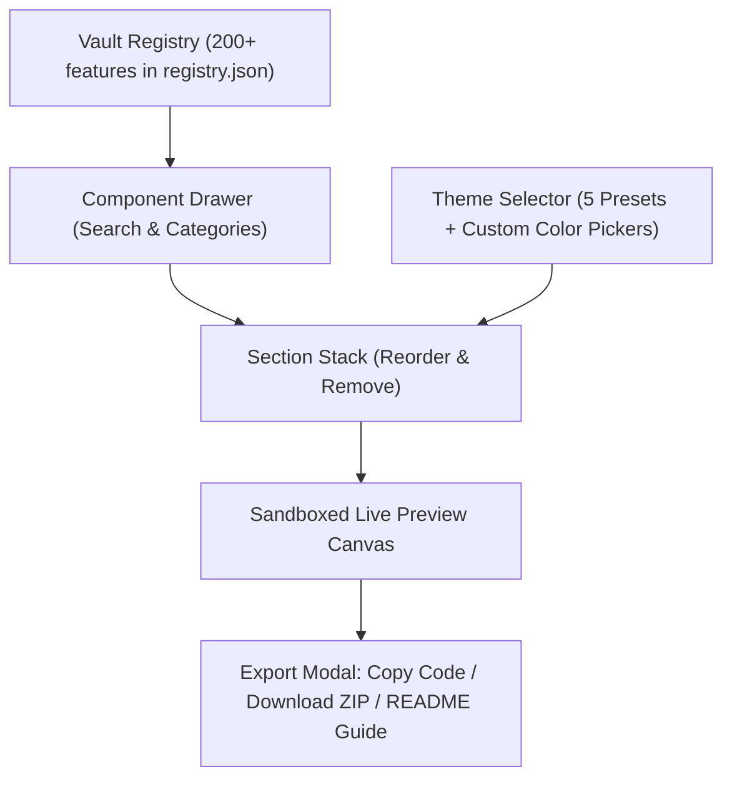

# Page Preview & Assemble Builder — Design Document

**Date:** 2026-10-22  
**Status:** Approved for Planning  
**Project:** `web-for-options` Feature Vault

---

## 1. Intent & The Why

`web-for-options` currently houses over 200 standalone creative features, components, 3D elements, and navigation patterns. Discovering and previewing how different combinations look and feel together as a coherent website is currently a manual process.

The **Page Preview Builder** provides a rapid assembly and preview tool. Users can pick features from the vault (headers, heroes, 3D carousels, feature grids, buttons, footers), stack them in any order, apply prepared or custom color themes, inspect the combined page in an instant live preview, and export a complete package of files/code that works immediately out of the box and is clean and easy to edit in any target project.

---

## 2. Goals, Non-Goals & Anti-Goals

### Goals
- **Side-by-Side Workspace:** Left panel hosts the builder controls (page stack, theme picker, component drawer); right panel hosts the live, responsive preview canvas.
- **Dynamic Section Stacking:** Add, remove, and drag-and-drop or click to reorder any section.
- **Theming System:**
  - One-click **prepared color templates** (e.g., Midnight Dark, Clean Minimal, Cyber Glow, Warm Editorial, Modern Slate).
  - **Custom color overrides** allowing direct tuning of background, text, and accent colors.
  - Global CSS variables (`--preview-bg`, `--preview-text`, `--preview-accent`, etc.) injected into section wrappers so all stacked blocks adopt the theme.
- **Interactive Live Preview:**
  - Instant live rendering inside an isolated sandbox preview iframe to prevent DOM/CSS/JS collisions between components.
  - Viewport switcher (Desktop, Tablet, Mobile) and "Open in New Tab" for fullscreen testing.
- **Export & Integration Package:**
  - **Out-of-the-Box Functionality:** Exported files (`index.html`, `style.css`, `script.js`, and local assets) must be 100% functional when copied into a new project—no build step or bundler required.
  - **Clean & Editable:** `index.html` has clear comments separating each section (`<!-- Section 1: Hero -->`); `style.css` isolates section rules with CSS variables at the top; `script.js` wraps animations in safe initialization blocks.
  - **Single-File Option & ZIP Download:** One-click copy for code tabs, standalone `.html` bundle, and a "Download Project ZIP" button.
  - **Page Manifest (`README.md`):** Documents the list of sections used, dependencies (if any), and where to edit text, images, and theme colors.

### Non-Goals
- Not a complex drag-and-drop WYSIWYG editor (no manual pixel nudging, resize handles, or inline rich text editing).
- Not modifying the original standalone source files inside `features/<slug>/`.
- Not a multi-page site builder (focused on single-page rapid prototyping).

### Anti-Goals
- **Collisions & Broken Runtime:** Must not allow multiple stacked features (e.g., those using `#root` or `requestAnimationFrame`) to collide or break scrolling.
- **Opaque Black Box Exports:** Exported code must not be an uneditable, minified blob; it must be structured and readable so the developer can continue customizing it in their target project.

---

## 3. Architecture & User Workflow

### 3.1 Dedicated Workspace (`builder.html`)
- Lives in `builder.html`, linked directly from the top navigation bar in `index.html` ("Page Builder" tab).
- Keeping it in `builder.html` ensures:
  1. Zero performance degradation or CSS conflicts with the main 21st.local catalog.
  2. Full screen estate for the side-by-side builder.

### 3.2 Builder Controls (Left Panel)
1. **Header & Theme Bar:**
   - Quick theme pill selector (Midnight Dark, Cyber Glow, Clean Minimal, Warm Editorial, Modern Slate).
   - "Custom Colors" toggle opening color pickers for Page Background, Text Color, and Primary Accent.
2. **Active Page Stack:**
   - Card list of currently selected sections.
   - Reorder buttons (Move Up / Down) and a Delete button.
   - Section type badges (Header, Hero, Carousel, Content, Button, Footer).
3. **"+ Add Section" Button:**
   - Opens a slide-out drawer or modal showcasing vault features grouped by category.
   - Search bar to find any component by name or tag.
   - "Add to Page" button on each card.
4. **Action Footer:**
   - "Clear All" button to reset the stack.
   - "Open in New Tab" to test the assembled page full-screen.
   - Primary "Export Project" button.

### 3.3 Live Preview Engine (Right Panel)
- Renders via an isolated iframe.
- Section HTML is injected into structured `<section class="page-section" id="section-...">` containers.
- Viewport size switcher: Desktop (100%), Tablet (768px), and Mobile (375px).
- Scripts and styles are encapsulated so animations and physics run independently without global scope pollution.

### 3.4 Export Engine
When the user clicks "Export Project":
1. **Modal with 3 Tabs:**
   - **Download ZIP:** Complete package containing `index.html`, `style.css`, `script.js`, and `README.md`.
   - **Copy Code:** Syntax-highlighted code viewers with one-click "Copy HTML", "Copy CSS", and "Copy JS" buttons.
   - **Single-File Bundle:** Self-contained all-in-one HTML file for rapid sharing or prototyping.
2. **Structure of Exported Files:**
   - `index.html`: Clean HTML5 boilerplate with `<header>`, `<main>`, `<section>`, and `<footer>` blocks, with helpful comments pointing out editable copy and media.
   - `style.css`: Global CSS variables for the chosen theme, base resets, and scoped section styles.
   - `script.js`: Namespaced component controllers with an `init()` orchestrator.
   - `README.md`: Guide describing how to run the project, swap assets, and adjust styling.

---

## 4. Technical Implementation Calls Made

1. **Isolation Strategy:** The live preview uses an iframe sandbox, scoping IDs and styles to prevent React `#root` mounting clashes and fixed 100vh viewport locks.
2. **Theming Scope:** CSS variables govern page background, typography colors, surface backdrops, borders, and buttons. Internal graphic shaders, canvases, and SVGs retain their native fidelity.
3. **Routing & Access:** Dedicated `builder.html` with direct navigation linking from `index.html`, preserving catalog simplicity and builder performance.
4. **Editable Exports:** The export assembler formats markup and CSS with clean indentation and section headers so developers can immediately start modifying the code in their IDE.
